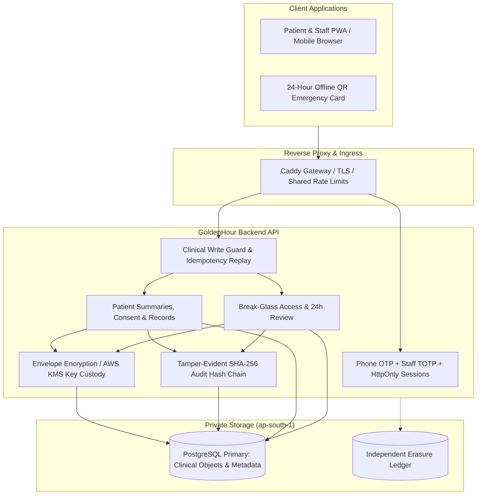

# 🏥 GoldenHour

> **Privacy-First Single-Hospital Emergency Medical Summary Access System with Phone OTP + Staff TOTP, Envelope Encryption (AES-256-GCM + AWS KMS), Tamper-Evident Hash-Chained Audit Logging, and Independent Erasure Ledger.**

For current hospital-pilot capabilities, deployment guides, and launch evidence, see [Hospital Deployment Guide](docs/HOSPITAL_DEPLOYMENT.md), [Final Scoped Plan](docs/FINAL_SCOPED_PLAN.md), and [API Reference](docs/api.md).

GoldenHour provides instant access to critical medical summaries (allergies, medications, chronic conditions, blood group) in life-threatening emergencies **without sacrificing patient privacy or data sovereignty**.

---

## 🚀 Architecture Overview



---

## ✨ Core Capabilities & Engineering Hardening

### 1. Robust Authentication & Session Management
- **Phone OTP for Patients:** 6-digit cryptographic OTP over SMS (expires in 5 minutes, 5-attempt lockout, replay protection).
- **Staff TOTP Multi-Factor Authentication (RFC 6238):** Required for all clinical and administrative personnel with emergency recovery codes.
- **HttpOnly Cookie Sessions:** Strict `SameSite=Strict`, `HttpOnly`, `Secure` session cookies (`gh_access` for 15-minute access, `gh_refresh_token` for 7-day rotating refresh) preventing token exposure to client-side scripts.
- **Shared Throttling:** Distributed rate limiting backed by PostgreSQL (`http_rate_limits`) preventing brute-force attacks across clustered instances.

### 2. Envelope Encryption & Key Custody
- **AES-256-GCM Encryption:** Every clinical record and sensitive field is encrypted with a unique Data Encryption Key (DEK).
- **Authenticated Associated Data (AAD):** Cryptographically binds the ciphertext to the patient ID and record ID to prevent cross-patient injection or transposition attacks.
- **Master Key Custody:** Key encryption keys (KEK) managed via AWS Key Management Service (AWS KMS in `ap-south-1`) or local Key Registry.
- **Verifiable Key Destruction:** Cryptographic shredding permanently destroys DEKs on approved patient erasure, rendering past backups mathematically undecryptable.

### 3. Time-Bounded Emergency Break-Glass & Governance
- **15-Minute Critical Window:** Verified emergency clinicians access life-saving summaries under trauma reason codes and clinical justification.
- **View-Level Auditing:** Every individual fetch of critical data during the window logs an append-only audit event.
- **Mandatory 24-Hour Peer Review:** Break-glass events enter an administrative review queue requiring peer clinician or administrator sign-off.
- **Offline Emergency Card:** Encrypted 24-hour offline QR token stored locally in the PWA for emergency triage without network dependency.

### 4. Tamper-Evident Audit Chain & Verified Export
- **SHA-256 Cryptographic Hash Chain:** Audit events are linked sequentially with previous-hash anchoring.
- **Database Trigger Lockdown:** PostgreSQL append-only triggers forbid `UPDATE` and `DELETE` on `audit_events`.
- **Bounded Audit Export:** Administrators export cryptographically verified audit segments in CSV and PDF formats with automatic segment hash validation.
- **Historical Attribution:** Preserves immutable hashes while joining legacy wallet actors to migrated user accounts.

### 5. Independent Erasure Ledger & Disaster Recovery
- **Two-Phase Erasure Protocol:** Erasure intent is committed to an independent append-only ledger prior to local deletion.
- **Fail-Closed Outage Protection:** Primary application traffic is blocked until all ledger receipts are replayed (`assertErasureLedgerApplied`).
- **Comprehensive Cleanup:** Purges encrypted objects, mutation replay caches, break-glass events, emergency cards, and active sessions.

### 6. Full Multilingual Localization & Accessibility
- **English, Tamil, and Hindi:** Native translations across all dashboards, emergency scan views, and legal notices.
- **WCAG Accessibility:** Keyboard navigation, skip-links, high-contrast indicators, and reduced-motion support.

---

## 🛠️ Technology Stack

| Layer | Technology |
|---|---|
| **Frontend** | React 18, Vite, React Router v6, QRCode.react, jsQR (on-device camera decoding) |
| **Backend** | Node.js 24+, Express.js, Helmet, Express-Rate-Limit, JSON Web Tokens (JWT), OTPAuth |
| **Database** | PostgreSQL 18 / 16 (`pg`), Idempotent SQL Migrations (001–018) |
| **Cryptography** | AES-256-GCM Envelope Encryption, SHA-256 Audit Hash Chain, AWS KMS SDK |
| **DevOps & Ingress**| Caddy Gateway (TLS / HSTS / Permissions-Policy), Docker, Terraform (ap-south-1) |
| **Testing** | Node Test Runner (`node:test`), Playwright (Chromium), Supertest |

---

## 🚦 Local Setup & Running Instructions

### Prerequisites
- Node.js >= 24.0.0
- npm >= 10.0.0
- PostgreSQL >= 16 (or Docker Compose)

### 1. Repository Setup & Dependencies
```bash
git clone https://github.com/Dharaneeshsl/Golden-Hour.git
cd Golden-Hour
npm run install:all
```

### 2. Environment Configuration
Copy `.env.example` to `backend/.env`:
```bash
cp backend/.env.example backend/.env
```
Generate secure keys:
```bash
node -e "console.log('JWT_SECRET=' + require('crypto').randomBytes(32).toString('hex'))"
node -e "console.log('ENCRYPTION_KEY=' + require('crypto').randomBytes(32).toString('base64'))"
```

### 3. Run Database Migrations
```bash
npm --prefix backend run db:migrate
```

### 4. Start Development Servers
```bash
# Terminal 1: Backend API
npm run backend

# Terminal 2: Frontend PWA
npm run frontend
```
- **Frontend App:** `http://localhost:5173`
- **Backend API Health:** `http://localhost:4000/health`

---

## 🧪 Quality Assurance & Test Verification

GoldenHour maintains a unified automated verification pipeline:

```bash
# Run full 5-gate baseline verification (backend tests, frontend tests, builds, secret scan)
npm run verify:code

# Run live PostgreSQL integration tests (requires local or test database)
npm --prefix backend run test:postgres
```

---

## 📄 License & Clinical Notice

> ⚠️ **Clinical Safety Notice:** GoldenHour v1 is engineered for single-hospital deployment in India (`ap-south-1`). Prior to real-patient deployment, independent penetration testing, clinical workflow approval, and statutory legal sign-off are required.
