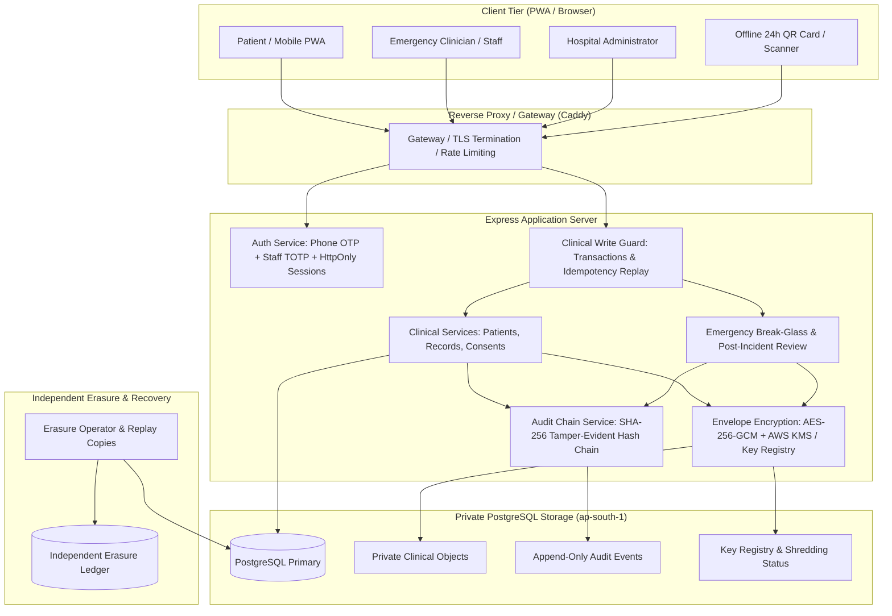

# GoldenHour Architecture

Single-Hospital Emergency Medical Summary Architecture (v1 — ap-south-1).

## Security & Architecture Pillars

1. **Authentication & Identity:**
   - Patient phone OTP (SMS via approved gateway) and invited staff TOTP (RFC 6238 MFA).
   - SameSite=Strict HttpOnly session and rotating refresh cookies (`gh_access`, `gh_refresh_token`).
   - Advisory-locked idempotency guard (`clinicalWriteGuard`) for transactional mutations and network drop replay.

2. **Encryption & Key Custody:**
   - Envelope encryption using **AES-256-GCM** with authenticated associated data (AAD) binding patient ID and record ID.
   - Master Key custody via AWS Key Management Service (KMS) or secure Key Registry.
   - Genuine cryptographic shredding (`[CRYPTO_SHREDDED_PERMANENTLY_DESTROYED]`) on patient clinical erasure.

3. **Audit Trail & Integrity:**
   - Cryptographic SHA-256 hash chain with database triggers forbidding `UPDATE` and `DELETE` on `audit_events`.
   - Admin-only bounded audit export in CSV and PDF with segment hash validation.
   - Full historical attribution joining legacy wallet identifiers to migrated user accounts without modifying historical hashes.

4. **Emergency Break-Glass:**
   - Time-bounded (15-minute) critical summary access requiring confirmed patient identity and clinical justification.
   - Peer and administrative review workflow within 24 hours of break-glass access.
   - 24-hour offline emergency QR card with explicit patient consent and sign-out cleanup.

5. **Compliance & Erasure:**
   - Independent append-only erasure ledger guaranteeing fail-closed operation during ledger or replication outages.
   - Retention hold checks and automated cleanup of replay caches, emergency cards, and active sessions.
   - HL7 FHIR R4 International Patient Summary (IPS) export strictly restricted to the patient.
